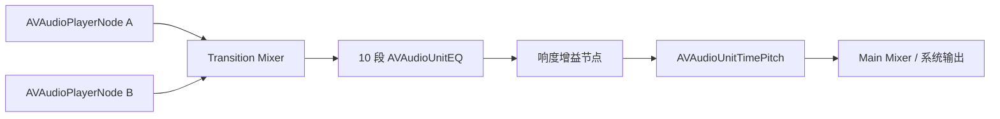

# PureTune（纯音）

PureTune 是一个完全离线的 iOS 本地音乐播放器。应用不包含账号、登录、广告、会员、在线音乐服务或业务网络请求。导入的音频只保存在应用自己的沙盒内。

当前版本：`2.1.2 (5)`，最低支持 iOS 16。

## 核心能力

### 本地音乐库

- 使用 `UIDocumentPickerViewController` 多选导入音频，以 `asCopy` 模式兼容“我的 iPhone”、iCloud Drive 和第三方文件提供器。
- 导入时显示逐文件进度，并区分空文件、无扩展名、无音轨、解码失败和复制失败。
- 使用 `AVURLAsset` 读取标题、歌手、专辑和时长，导入后验证可播放性与时长。
- 曲库索引保存在 `Documents/PureTune/library.json`，最近播放历史保存在 `history.json`。
- 支持最近播放、最近添加、歌曲、专辑、艺术家分类。
- 支持列表与网格切换、按标题或最近添加排序、搜索和删除。
- 支持从音频文件读取内嵌封面，使用内存缓存并异步加载，避免阻塞列表滚动。

### 真实音频处理

- 播放引擎由 `AVPlayer` 迁移为 `AVAudioEngine`。
- 使用双 `AVAudioPlayerNode` 实现切歌时同时淡出旧曲、淡入新曲。
- 10 段 `AVAudioUnitEQ`：31 Hz、62 Hz、125 Hz、250 Hz、500 Hz、1 kHz、2 kHz、4 kHz、8 kHz、16 kHz。
- EQ 预设：原声、流行、摇滚、古典、爵士、人声、低音增强、自定义。
- EQ 参数切换使用短时平滑插值，避免突然跳变产生爆音。
- 自定义 EQ、预设、开关、音量、淡入淡出和播放速度均持久化保存。
- 音量均衡通过离线分析文件真实 PCM 响度与峰值计算安全增益，不使用固定增益冒充。
- 播放速度使用 `AVAudioUnitTimePitch`，保持音高不变，支持 0.75x、1.0x、1.25x、1.5x、2.0x。
- 音源信息直接读取当前文件的格式、编码、采样率、位深、声道、文件大小、时长和可判定的无损/有损编码。

### 播放与系统集成

- 支持顺序播放、单曲循环、列表循环、随机播放。
- 支持播放、暂停、上一首、下一首、拖动进度和应用内音量。
- 支持后台播放、锁屏信息、锁屏进度拖动、耳机与蓝牙远程控制。
- 处理音频中断、媒体服务重置和外接设备断开。
- 播放进度由独立 `PlaybackClock` 发布，完整播放器和迷你播放器只刷新各自的进度子视图。
- 播放期间才运行 0.5 秒进度时钟；暂停、进入后台或失去活跃状态时停止，回到前台后同步真实播放时间。

### 视觉与主题

- 支持跟随系统、浅色、深色三种主题，选择持久保存。
- 音乐库、搜索、音效、设置、迷你播放器和完整播放器统一适配。
- 使用系统 `Material`、动态光影、柔和极光和渐变描边构建玻璃层级。
- 在支持原生 Liquid Glass 的新系统上继续沿用系统材质能力；旧系统使用 SwiftUI Material 降级。
- 播放器使用真实封面作为模糊背景，并提供大封面、音源标签、播放模式、音量和音效入口。
- 超长歌曲名自动循环滚动，短歌曲名保持静止；进入后台或开启“减少动态效果”时停止滚动。
- 极光背景在应用非活跃时停止循环动画，减少后台无关渲染。
- 通过 `CADisableMinimumFrameDurationOnPhone` 允许系统为 ProMotion 设备调度更高刷新率；实际帧率仍由系统、温控和功耗策略决定。
- 横竖屏均提供自适应布局。

## 项目结构

```text
PureTune/
├── PureTune/
│   ├── App/
│   │   └── PureTuneApp.swift
│   ├── Assets.xcassets/
│   │   └── AppIcon.appiconset/
│   ├── Design/
│   │   └── AppTheme.swift
│   ├── Models/
│   │   ├── AudioSettings.swift
│   │   └── Song.swift
│   ├── Services/
│   │   ├── ArtworkStore.swift
│   │   ├── AudioEffectsManager.swift
│   │   ├── AudioPlayer.swift
│   │   ├── EqualizerManager.swift
│   │   ├── MusicLibrary.swift
│   │   ├── PlaybackClock.swift
│   │   ├── SettingsManager.swift
│   │   └── ThemeManager.swift
│   ├── Views/
│   │   ├── ArtworkView.swift
│   │   ├── ContentView.swift
│   │   ├── DocumentPicker.swift
│   │   ├── EffectsView.swift
│   │   ├── GlassTabBar.swift
│   │   ├── LibraryHomeView.swift
│   │   ├── MiniPlayerView.swift
│   │   ├── NowPlayingView.swift
│   │   ├── PlayerDock.swift
│   │   ├── SearchView.swift
│   │   ├── SettingsView.swift
│   │   └── SongRow.swift
│   └── Info.plist
├── project.yml
├── .github/workflows/build-unsigned-ipa.yml
└── README.md
```

## 数据存储

应用首次启动后会创建：

```text
<App 沙盒>/Documents/PureTune/Music/
<App 沙盒>/Documents/PureTune/library.json
<App 沙盒>/Documents/PureTune/history.json
```

`Music/` 保存导入后的音频副本，`library.json` 保存歌曲元数据，`history.json` 保存最近播放顺序。卸载应用会删除这些数据。

## 音效实现说明

音频节点链路：



- 两个播放节点用于切歌淡入淡出。
- EQ 关闭时节点旁路，恢复未经 EQ 处理的声音。
- 响度均衡只应用根据文件 PCM 分析得到的安全增益，并受峰值余量限制。
- 音量控制是应用内增益，不越过系统或硬件音量限制。
- 不会宣称 EQ、升采样或应用内增益提高了原始音源质量。

## 环境要求

- iOS 16.0 或更高版本
- Xcode 15 或更高版本
- XcodeGen
- 无需 Apple Developer 付费账号即可完成未签名编译

## 本地生成与编译

```bash
brew install xcodegen
xcodegen generate --spec project.yml
open PureTune.xcodeproj
```

仅验证未签名构建：

```bash
xcodebuild \
  -project PureTune.xcodeproj \
  -scheme PureTune \
  -configuration Release \
  -sdk iphoneos \
  -destination 'generic/platform=iOS' \
  -derivedDataPath build \
  CODE_SIGNING_ALLOWED=NO \
  CODE_SIGNING_REQUIRED=NO \
  build
```

## GitHub Actions 构建未签名 IPA

工作流文件：`.github/workflows/build-unsigned-ipa.yml`。

1. 推送到 `main` 分支或手动触发。
2. macOS Runner 安装 XcodeGen、生成工程并执行 Release 构建。
3. 校验 Bundle ID、显示名称、后台音频声明、图标和未签名状态。
4. 上传 Artifact `PureTune-unsigned-IPA` 并发布 `build-<run number>` Release。

未签名 IPA 必须由使用者自行签名，或使用 TrollStore 等工具安装。

## 音频格式说明

导入器接受系统可识别的音频文件。实际播放取决于 iOS 的 AVFoundation 解码器；MP3、AAC/M4A、WAV、AIFF 是优先验证格式，FLAC 等格式需在目标系统版本上实测。

如果歌曲位于 iCloud Drive，选择器会先等待系统下载副本；下载失败或提供器没有返回 URL 时，应用会显示明确错误。

## 隐私边界

- 不请求网络权限，不包含网络请求代码。
- 不申请账号、通讯录、相册、位置或麦克风权限。
- 不上传、分析或收集用户音乐库和个人信息。
- 所有音频副本、索引和最近播放历史都留在应用沙盒内。
